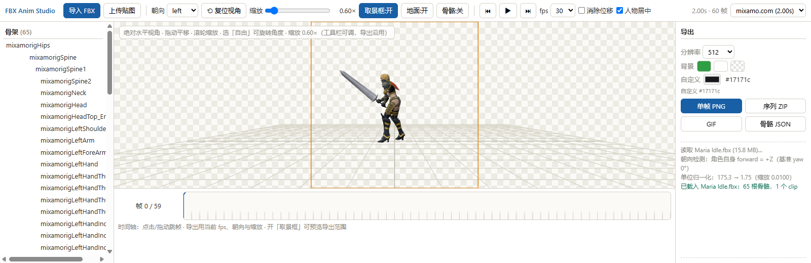
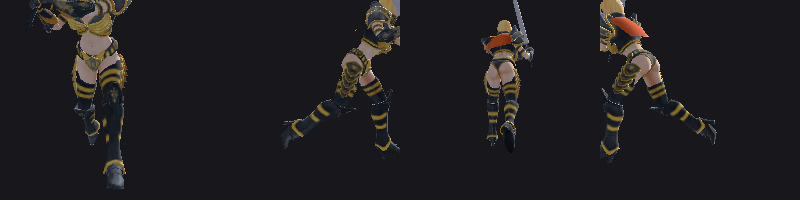
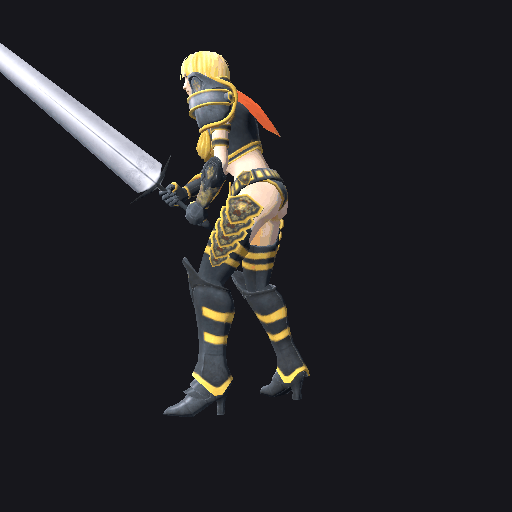
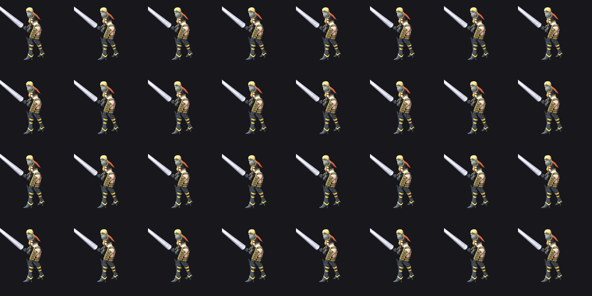
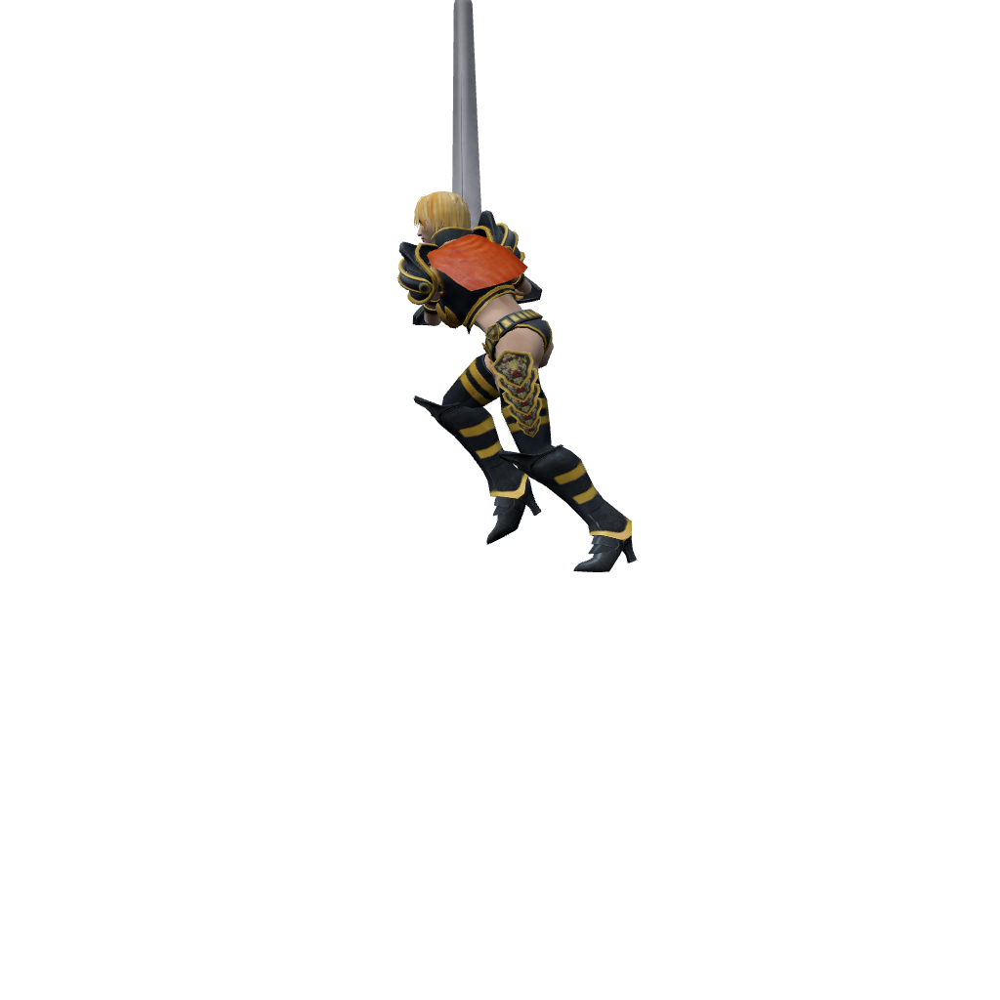

# FBX Anim Studio

**Language: [简体中文](README.md) · English**

> A browser-based FBX skeletal animation inspector & exporter: import an FBX (with external textures) → normalize / center / set facing → play frame by frame → export PNG sequences, GIF, and skeleton JSON. Pure frontend, zero install, plus a Godot command-line pipeline — no Blender or FBX SDK required.
>
> 浏览器端的 FBX 骨骼动画查看、微调与导出工具。纯前端零安装，另附一条 Godot 命令行管线。


**Current version: v1.1.0** — see [CHANGELOG.md](CHANGELOG.md) for the changelog.

## Table of Contents

- [Introduction](#introduction)
- [Features](#features)
- [Screenshots](#screenshots)
- [Quick Start](#quick-start)
- [Usage](#usage)
- [Output Data Format](#output-data-format)
- [Project Structure](#project-structure)
- [Technical Highlights](#technical-highlights)
- [Requirements](#requirements)
- [Known Limitations](#known-limitations)
- [License](#license)

---

## Introduction

This repository contains **two independent FBX animation extraction pipelines** that share the same output conventions (identical facing semantics and the same `bones.json` format):

| Pipeline | Entry point | Renderer | Best for |
|---|---|---|---|
| **FBX Anim Studio** (web, recommended) | repo root | three.js + WebGL | Manual inspection, frame-by-frame tuning, single/few-clip exports; zero install |
| **fbx-anim-tool** (command line) | `fbx_anim_tool.py` | Godot 4.7 + Vulkan offscreen | Unattended batch extraction; bones / PNG sequence / GIF only |

Typical workflow: dial in framing, facing, and zoom in the web tool → run the same settings across the whole character library with the CLI pipeline.

---

## Features

### FBX Anim Studio (web)

- **Import and go**: load an FBX via button or drag-and-drop; when textures are external PNGs (e.g. Mixamo's `Maria *_0.png`), upload them together and they attach to the materials
- **Auto-normalization**: every model is uniformly scaled to 1.75 m on load — Mixamo's centimeter units included — so cameras, meshes, and joint spheres are consistent across models
- **Automatic facing detection**: measures the world-space X distribution of all `Left*` / `Right*` bones to determine the character's own forward (+Z or −Z), which makes the four facing options **exact multiples of 90°**
- **Autodesk FBX Review-style view**: choosing left / right / front / back enters an absolute horizontal view (zero pitch, horizon through the frame center) with rotation locked for a standard side/front view at all times; "Free" restores full orbit rotation
- **Framing box**: the orange rectangle in the viewport *is* the actual export frame — anchored to the world origin and resizing live with zoom
- **Frame-by-frame playback**: spacebar play/pause, `←` `→` step, timeline click/drag to scrub, fps 12–60 selectable
- **Remove translation / center character**: in-place playback (x/z pinned to the baseline, vertical bounce preserved); the character is pinned to frame center every frame so sequences don't drift
- **Four export types**: single-frame PNG, PNG-sequence ZIP (with `meta.json`), GIF, and skeleton JSON
- **Godot animation export**: one click produces a native Godot Animation resource (`.tres`) — attach it to an AnimationPlayer and play
- **Controllable background**: green / white presets, pure transparency (PNG keeps alpha), custom color picker; GIF transparency uses a dedicated palette index for hard-edge cutouts
- **Fixed-camera framing**: sequence export calibrates one camera on frame 0 (skeleton coarse alignment + pixel-centroid iterative convergence) shared by the whole sequence — the camera never moves between frames

### fbx-anim-tool (CLI)

- **One command, full output**: `bones.json` + 30 fps PNG sequence + GIF + contact-sheet thumbnails + **a Godot Animation resource (`animation.tres`)**
- **Native .tres**: generated inside Godot against the real skeleton — numerically exact (`--no-tres` to skip)
- **Bones only**: `--no-render --no-gif` finishes in seconds
- **Independent facing / camera**: `--facing` only rotates the model; `--cam` fixes the world camera direction
- **In-place playback**: zeroes the hip position track's x/z (keeps y) by default so run cycles play in place
- **Frame-accurate GIF**: distributes incremental delays along the ideal cumulative timeline — measured 30.00 fps (24 / 60 fps equally precise)

---

## Screenshots



Four-way facing comparison (front / left / right / back, all exact 90°):



CLI pipeline output — 30 fps looping GIF and contact sheet:





A 1024×1024 transparent-background sequence frame exported by the web tool (Maria Run):



---

## Quick Start

### Option 1: Web tool (recommended)

```bash
python -m http.server 8799
# open http://127.0.0.1:8799/ in your browser
```

On Windows you can also double-click `start.bat` (starts the server and opens the browser automatically).

> ES modules are blocked on `file://` by browsers, so http is required. All dependencies are vendored under `vendor/` — **works fully offline**.

### Option 2: Command line

```bash
# most common: generate a left-facing GIF + bone data from an FBX
python fbx_anim_tool.py "D:\Downloads\3D 动作人物模型\Maria\Maria Run.fbx" -o output/run --sheet
```

Output in `output/run/`:

| File | Contents |
|---|---|
| `bones.json` | local / global TRS (quaternion xyzw) for 65 bones per frame |
| `animation.tres` | Godot 4.3+ Animation resource, attachable to an AnimationPlayer |
| `frame_0000.png` … | 30 fps per-frame renders |
| `animation.gif` | 30 fps looping GIF |
| `meta.json` | animation name, frame count, bone table, facing, available clips |
| `contact_sheet.png` | thumbnail grid for quick visual verification (enable with `--sheet`) |

The Godot executable is required; override the default paths with environment variables:

```bash
export FBXAT_GODOT="E:\AI\Godot_v4.7.2-stable_mono_win64\Godot_v4.7.2-stable_mono_win64_console.exe"
export FBXAT_HOST_PROJECT="D:\path\to\any\godot\project"
```

---

## Usage

### Web tool

**Import & textures**

1. Click "导入 FBX" (Import FBX) or drag a `.fbx` straight into the viewport. The model is auto-normalized to 1.75 m, grounded and centered, facing left.
2. When textures are external PNGs, click "上传贴图" (Upload Textures) and select them together (e.g. `Maria Idle_0.png` ~ `Maria Idle_2.png`); embedded textures need no action.
3. The log bar prints the facing-detection and unit-normalization results — check them to confirm the import matches expectations.

**Playback & inspection**

- Spacebar play/pause, `←` `→` step frame; click/drag the timeline to scrub.
- "骨骼:开" (Skeleton: on) shows bone lines and joint spheres; click a sphere in the viewport to select a bone (the left skeleton tree highlights in sync).
- "消除位移" (Remove translation, default off): strips the forward walk/run displacement so the character acts in place; vertical bounce is preserved. When off, the exported skeleton JSON carries the real locomotion.
- "人物居中" (Center character, default on): pins the character to frame center every frame so exported GIF / PNG sequences don't drift.

**Framing & facing**

- **Zoom**: mouse wheel or the toolbar slider; with the slider focused, `←` / `→` fine-tunes by 0.01, `Shift+←/→` by 0.1, double-click resets to default. **Exports frame at the current zoom** (default 0.60×).
- **Framing box** (default on): everything inside the orange rectangle is the actual export frame. The box is anchored to the world origin and resizes live with zoom.
- **Facing**: left / right / front / back (default left). The camera stays fixed; only the model rotates:

  | Option | Character facing (screen coords) |
  |---|---|
  | front | faces the camera (+Z) |
  | left  | front rotated 90° CCW → screen left (−X) |
  | right | front rotated 90° CW → screen right (+X) |
  | back  | back to the camera (−Z) |

- The four direction modes enter an **absolute horizontal view** (camera at target height, zero pitch) with rotation disabled (drag = pan, wheel = zoom); "自由" (Free) restores orbit rotation. `⟲ 复位视角` (Reset view) returns to the standard horizontal pose and resets zoom to 0.60×.

**Export**

| Button | Output |
|---|---|
| 单帧 PNG (Single PNG) | current frame, selectable resolution (256 / 512 / 768 / 1024 / 2048) |
| 序列 ZIP (Sequence ZIP) | all frames as PNG + `meta.json`, packed with fflate |
| GIF | GIF89a + LZW encoding, frame delays distributed along the cumulative timeline (exact 30 fps) |
| 骨骼 JSON (Skeleton JSON) | per-frame per-bone local + global TRS (same convention as the CLI tool) |
| Godot 动画 (Godot anim) | Godot 4.3+ Animation resource (`.tres`) — see below |

- Background color: green / white presets + checkerboard "pure transparency" + custom color picker; applies to PNG (single/sequence) and GIF.
- Pure transparency: PNG keeps the alpha channel; GIF uses a transparency index (slot 255 is reserved, so pure black is never keyed out).
- Exports auto-hide joint spheres and bone lines; in pure-transparency mode the ground grid is hidden too.
- Framing strategy: with **center character on**, the whole sequence shares the camera calibrated on frame 0 (no inter-frame shake); with it **off**, the camera is fixed at the world origin and the character crosses the frame per its real locomotion; **single-frame PNG** runs the full framing iteration on the current frame, landing the character exactly at frame center.

**Godot animation (.tres)** — convert the current clip into a native Godot Animation resource; copy it into your Godot project and use it directly:

- Tracks: position / rotation / scale per bone, path `Skeleton3D:<bone_name>`; names follow Godot's imported-skeleton convention (`mixamorig:Hips` → `mixamorig_Hips`); tracks that never change collapse to a start/end key pair to keep the file small
- Units: positions convert from the FBX's raw units to metres (×0.01, matching Godot's FBX import); rotations pass through — three.js and Godot are both right-handed, Y-up, quaternion xyzw
- Usage:

  ```gdscript
  var lib := AnimationLibrary.new()
  lib.add_animation("idle", load("res://maria_idle_anim.tres"))
  $AnimationPlayer.add_animation_library("", lib)
  $AnimationPlayer.play("idle")
  ```

- Accuracy: Godot round-trip tests (apply to the imported Maria skeleton, read poses back) land within 0.35 mm / 0.11° of the source data — the residual is the two engines' keyframe interpolation precision, invisible in practice; for bit-exact output use the CLI (it generates inside Godot against the real skeleton)
- Prerequisite: the FBX is in centimetres (Mixamo et al.). For metre-unit FBX, adjust `FBX_CM_TO_M` in `app.js`

**Batch export (CLI-driven page)**

Batch-export a folder of FBX files to image sequences with one set of parameters, no clicking:

```bash
# 1) page server (the tool itself)          :8799
python -m http.server 8799
# 2) disk-write receiver (bypasses cancelled blob downloads)  :8800
python save_server.py
# 3) batch run (pass any FBX folder; defaults to the Maria folder)
bash batch_export.sh "D:/Downloads/3D 动作人物模型/Maria"
```

Output: one subfolder per FBX named after it, containing `Maria_Run_f0000.png` … (1024×1024 RGBA transparent).
`export_via_receiver.js` is the in-page render script (per-frame `renderFrameAt` → POST to the receiver for disk writes); resolution / background / zoom are set in its first few lines. It is driven by a headless-browser CLI and can be swapped for Playwright or any other automation.

### Command line

```bash
# bones only, no rendering (fastest)
python fbx_anim_tool.py model.fbx -o out --no-render --no-gif

# specific clip and resolution
python fbx_anim_tool.py model.fbx -a mixamorig_walk --facing left -W 1024 -H 1024

# 60 fps, infinite loop
python fbx_anim_tool.py model.fbx --fps 60 --loop 0

# keep the original root motion (default pins the hips so run cycles play in place)
python fbx_anim_tool.py model.fbx --no-in-place

# skip the Godot animation resource (animation.tres is produced by default)
python fbx_anim_tool.py model.fbx --no-tres
```

`--facing` sets which way the character faces (combined with `--cam side` for a side-view camera):

| Value | Model yaw | Effect |
|---|---|---|
| `left` (default) | +90° | side view, **facing screen left** |
| `right` | −90° | side view, facing screen right |
| `front` | 0° | front toward camera |
| `back` | 180° | back to camera |
| any number | that angle | custom fine-tuning |

Camera direction `--cam`: `side` (default) / `front` / `three_quarter`. The two are independent — the camera is a fixed world direction, `--facing` only rotates the model.

**Standalone GIF assembler** (no Godot needed):

```bash
python make_gif.py path/to/frames --fps 30 --bg "#17171c" --sheet
```

---

## Output Data Format

`bones.json` (the web tool's "Skeleton JSON" and the CLI share this convention):

```jsonc
{
  "animation": "mixamorig_run",
  "fps": 30.0,
  "frame_count": 18,
  "bone_count": 65,
  "facing_yaw_deg": 90.0,
  "convention": {
    "handedness": "left-handed (Godot)",
    "rotation": "quaternion xyzw",
    "pose_space": "bone-local, parent-relative to FBX bone rest"
  },
  "frames": [
    {
      "frame": 0,
      "time": 0.0,
      "local":  [ { "name": "mixamorig_Hips", "t": [x,y,z], "r": [x,y,z,w], "s": [x,y,z] } ],
      "global": [ { "name": "mixamorig_Hips", "t": [x,y,z], "r": [x,y,z,w] } ]
    }
  ]
}
```

`local` is the parent-relative pose, suitable for driving an engine's skeleton; `global` is the world pose, suitable for direct IK or collision placement (since v1.1.0 `local` is the true parent-relative pose — earlier versions exported identity due to three.js FBXLoader's twin-node structure). `bone_names` maps indices to bone names. A PNG sequence's `meta.json` additionally records the background color (`background` field), resolution, and frame count.

---

## Project Structure

```
FBX-Anim-Studio/
├── index.html                # UI and all styles (incl. the bottom-anchored info-log layout)
├── app.js                    # Web tool main logic: loading / playback / framing / export
├── gifenc.js                 # GIF89a + LZW encoder
├── start.bat                 # One-click Windows launcher (server + browser)
├── WEBAPP.md                 # Detailed web-tool documentation
├── vendor/                   # three.js r160 and addons, fully vendored
│   ├── three.module.js
│   ├── controls/OrbitControls.js
│   ├── loaders/FBXLoader.js
│   └── libs/fflate.module.js
├── fbx_anim_tool.py          # CLI entry point (Python orchestration)
├── make_gif.py               # PNG sequence → GIF assembler (Pillow only)
├── godot_project/            # Godot project for the CLI (GDScript extractor)
│   └── tools/                # anim_extractor.gd / run_extract.gd / run_extract.tscn
├── save_server.py            # CORS disk-write receiver for batch export (:8800)
├── export_via_receiver.js    # In-page per-frame render + POST-to-disk script
├── batch_export.sh           # Batch export driver script
├── clear_outputs.py          # Small utility to clean export outputs
├── diag_center.js            # Framing-centering diagnostic script
├── docs/                     # Screenshots and sample outputs used by this README
├── input/ output/            # Sample inputs and outputs (gitignored, not in the repo)
├── README.md / README.en.md  # Bilingual project intro (switch at the top)
├── CHANGELOG.md              # Changelog (Keep a Changelog + semver)
├── .gitignore
├── .gitattributes
├── LICENSE                   # MIT
└── README.md
```

---

## Technical Highlights

- **Rendering & parsing**: three.js r160 (vendored under `vendor/` + importmap), FBXLoader parses skeleton and AnimationPlayer, OrbitControls drives the camera; fflate packs ZIP in the browser
- **Unit normalization**: every model is uniformly scaled to 1.75 m on load, keeping camera / mesh / joint-sphere sizes consistent across models
- **Automatic facing detection**: measures the world-space X distribution of all `Left*` / `Right*` bones to determine the character's own forward, making the four facings exact multiples of 90°
- **Fixed-camera framing**: sequence export calibrates the camera on frame 0 (skeleton coarse alignment + pixel-centroid iterative convergence) and shares it across the sequence — the camera never moves, so the picture never shakes; single-frame export runs the full iteration on the current frame
- **In-place playback**: samples frame 0 to record the root-position baseline, then pins the root bone and model root's x/z back to it every frame (y preserved)
- **Zoom model**: `zoom = standard framing distance / current camera distance`, shared by wheel, slider, and export; the framing box computes its world size as `2·d·tan(fov/2)` and billboards toward the camera
- **GIF encoding**: midpoint-split quantization to 256 colors + LZW (with 4096-entry table-full reset), frame delays rounded along the cumulative timeline to avoid accumulated error; transparent GIFs reserve index 255 exclusively for transparency
- **Godot offscreen rendering**: `--headless` uses the dummy renderer, where `get_image()` only returns empty — so the CLI runs a minimal window (64×64, placed offscreen at 5000,5000) with the Vulkan backend, and a SubViewport produces the offscreen frames
- **Batch export pipeline**: per-frame in-page rendering → POST to a local receiver for disk writes, working around headless browsers cancelling blob downloads; git-bash does not expand `[012]` bracket globs, so textures are listed explicitly as `_0/_1/_2` with case-insensitive matching
- **Round-trip self-check**: `godot_project/tools/roundtrip_test.gd` loads any `.tres`, applies it to the imported skeleton, and reads poses back — run it inside a Godot project that has the FBX imported to verify an export

---

## Requirements

| Pipeline | Requirements |
|---|---|
| Web tool | Any modern browser (Chrome / Edge / Firefox); Python 3 only to serve static files (or any static server); no Node, no build |
| CLI | Python 3.10+, Pillow, Godot 4.x (requires Vulkan and a real GPU) |

---

## Known Limitations

- **The CLI requires a real GPU**: Godot's dummy renderer cannot produce offscreen images, so VMs / GPU-less environments won't work (the web tool uses WebGL and has no such restriction)
- **First-time Godot import of an external FBX is slow**: a 15 MB FBX takes roughly 1–3 minutes; already-imported files can skip it with `--no-import`
- **Batch export depends on a headless-browser CLI**: `batch_export.sh` invokes `agent-browser`, replaceable with Playwright or any automation (the in-page script `export_via_receiver.js` stays the same)
- **ES modules can't run from `file://`**: the web tool must be served over http
- **GIF has no semi-transparency**: transparent exports are hard-edge cutouts — use PNG for anti-aliased edges

---

## License

Released under the [MIT License](LICENSE).
